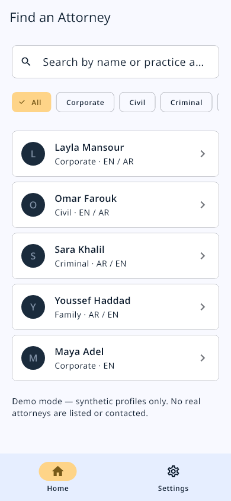
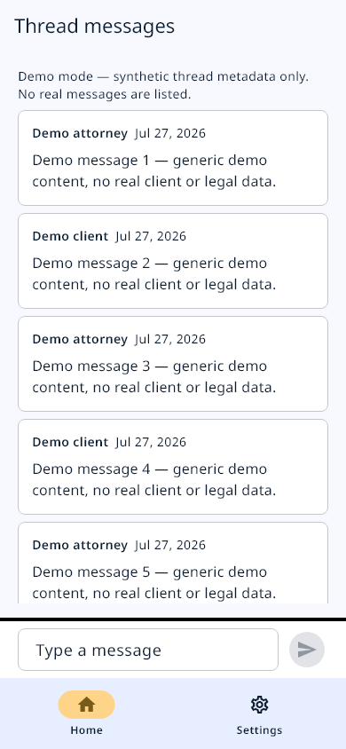
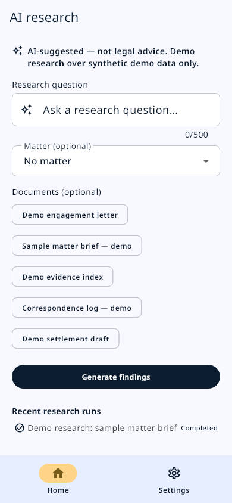
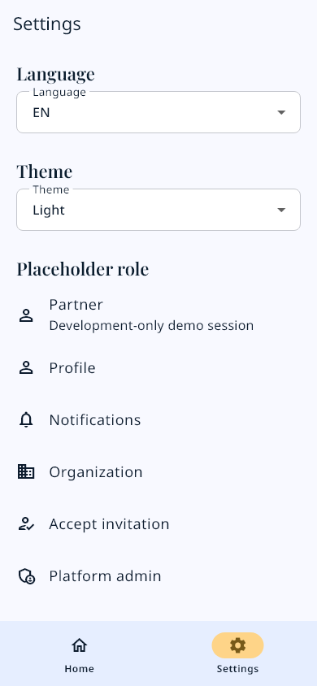
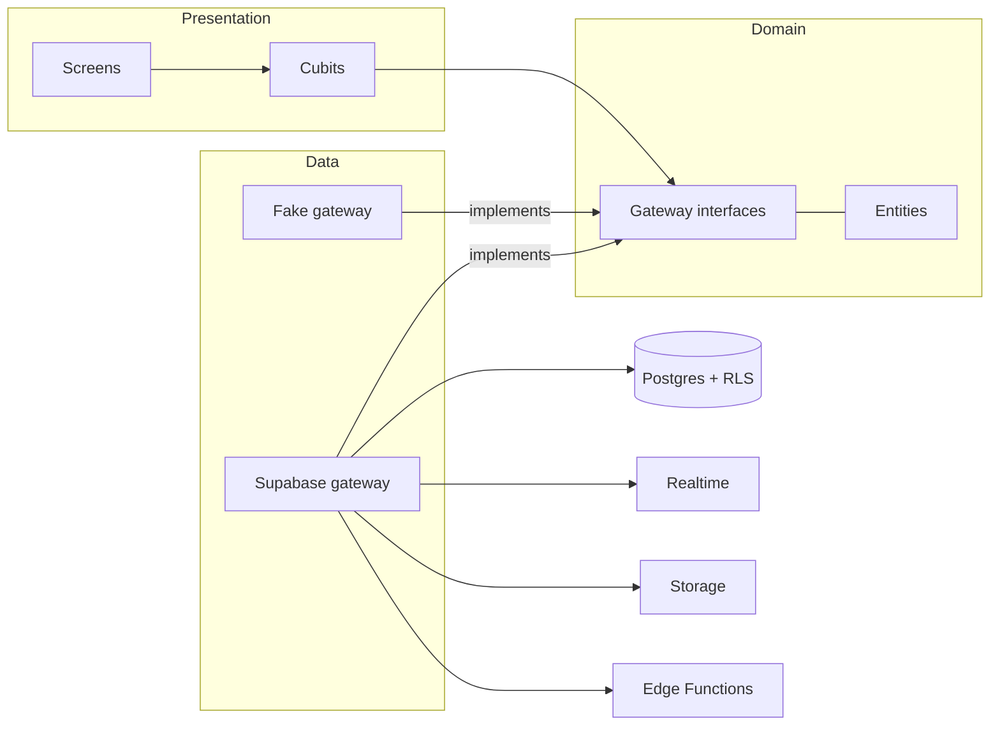
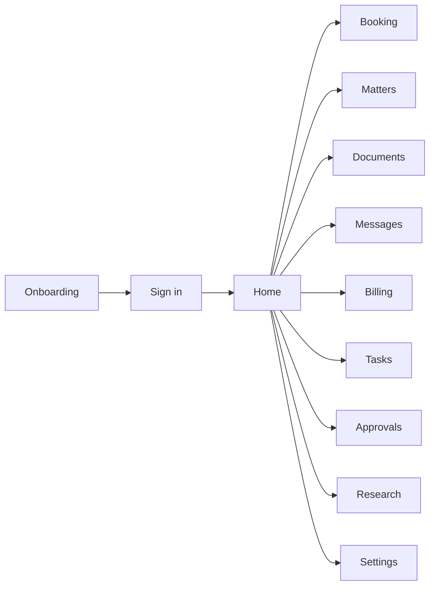

# LegalHub

A legal practice-management platform for law firms and their clients, built with Flutter and Supabase.

[](https://github.com/mostafasayed118/Law_App/actions/workflows/ci.yml)
[](https://flutter.dev)
[](LICENSE)

## What it is

LegalHub is a multi-tenant workspace where a law firm runs its day-to-day work: matters, a document vault, secure client messaging, consultation booking, invoicing, approvals and compliance alerts, plus video consultations and an AI research surface.
It is a real client/server application, not a UI mockup on local fixtures: Supabase Postgres with row-level security, 56 RPCs, Realtime, Storage and five Edge Functions.
A **Legal Library** (statutes, full-text search, bookmarks, highlights, reading history) is the planned next module. **It does not exist yet.**

## Screenshots

| | | |
|---|---|---|
|  |  |  |
|  |  |  |

A 30–40 second walkthrough is planned at `docs/media/demo.gif`; the capture checklist is in [`docs/media/README.md`](docs/media/README.md).

## Highlights

- **Clean Architecture with gateway seams.** Every feature splits into domain, data and presentation, and each data source sits behind a provider-neutral interface. The same UI runs on credential-free fakes or on Supabase; the build decides which.
- **Authorization is server-side.** 25 tables, 28 RLS policy files and 26 pgTAP suites, with every write funnelled through an RPC. The client refuses to start if it is handed a service-role key.
- **Three languages, right-to-left included.** English, Arabic and Turkish, 866 localized strings each, with Arabic typography and a layout matrix that proves RTL at 320px.
- **Phone to tablet.** One breakpoint contract drives the navigation rail, master/detail two-pane layouts, centred sheets and readable content width, down to foldable hinge geometry.
- **Genuinely tested.** 2,163 tests run and pass, 83% line coverage, plus a matrix that pumps every route across five widths and three text scales.
- **Runs without credentials.** Clone it, run it, click through every screen on a deterministic demo dataset.

## Architecture





## Tech stack

| Concern | Choice |
|---|---|
| Framework | Flutter 3.47.5 / Dart 3.13.4 |
| State | `bloc` + `flutter_bloc` (Cubits) |
| Routing and DI | `go_router` 17, `get_it` 9 |
| Backend | `supabase_flutter` 2 (Postgres, Realtime, Storage, Functions) |
| Storage | `flutter_secure_storage` 11 (session), `shared_preferences` 2 (preferences) |
| Media and links | `livekit_client` 2, `file_selector` 1, `url_launcher` 6, `app_links` 7 |
| Localization | `flutter_localizations` + `intl` |

## Quick start

Demo mode needs no account, no `.env` and no backend — every screen runs on the credential-free fakes:

```bash
flutter pub get
flutter run --flavor development -t lib/main_development.dart
```

To point the app at a Supabase project, copy the example file and fill in the URL and the **anon** key (a service-role key is rejected at startup):

```bash
cp .env.development.example .env.development
flutter run --flavor development -t lib/main_development.dart --dart-define-from-file=.env.development
```

Release builds and the full verification set (analyze, format, tests, SQL policy checks) are documented in [`docs/DEEP_DIVE.md`](docs/DEEP_DIVE.md).

## Roadmap

Available today:

- [x] Practice management: matters, tasks, approvals, compliance alerts
- [x] Authentication: email/password, OTP and deep-link recovery, Google sign-in
- [x] Booking, attorney discovery, realtime messaging
- [x] Document vault, invoicing (demo-mode payments), video consults, AI research
- [x] Organizations, roles and a platform-admin surface
- [x] English / Arabic / Turkish with RTL, responsive phone and tablet layouts

Planned:

- [ ] **Legal Library** — statutes, full-text search, bookmarks, highlights, reading history
- [ ] Push notification delivery
- [ ] Offline send queue
- [ ] Account deletion and profile editing
- [ ] Privacy policy and terms screens
- [ ] iOS release build and signing

## Engineering docs

- [`docs/DEEP_DIVE.md`](docs/DEEP_DIVE.md) — the full engineering record, slice by slice
- [`docs/adr/`](docs/adr/) — architecture decision records
- [`docs/permission_matrix.md`](docs/permission_matrix.md) — roles versus capabilities

## License

MIT — see [`LICENSE`](LICENSE).
