# LegalHub

A legal practice-management platform with a Legal Library — Flutter, Supabase, and a credential-free demo mode.

[](https://github.com/mostafasayed118/legalhub/actions/workflows/ci.yml)
[](https://flutter.dev)
[](LICENSE)

## What it is

A multi-tenant practice workspace: matters, document vault, secure messaging, consultation booking, invoicing, approvals, compliance alerts, video and AI research. The Legal Library adds browse, read, search, bookmarks, highlights and reading history over a **sample corpus** — every seeded row is badged as invented, and an importer brings in real text when supplied. Authorization is enforced in Supabase (RLS; app and user-data writes are RPC-only, while the three Legal Library corpus tables are RLS-restricted to the platform owner and written by the owner-run importer); the same UI runs on fakes or a configured backend.

## Screenshots

| | | |
|---|---|---|
| 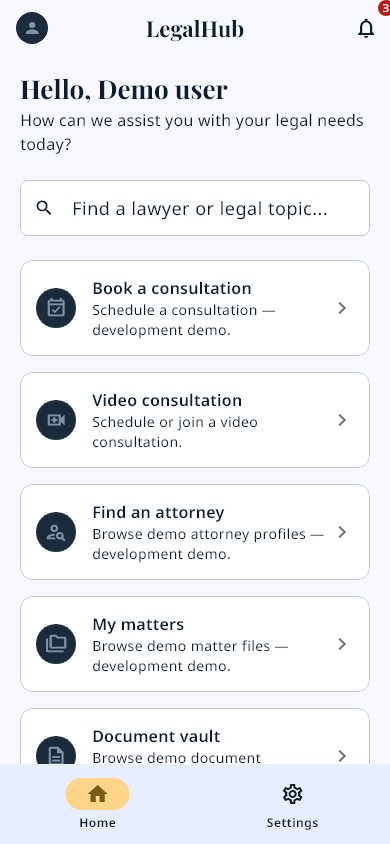 | 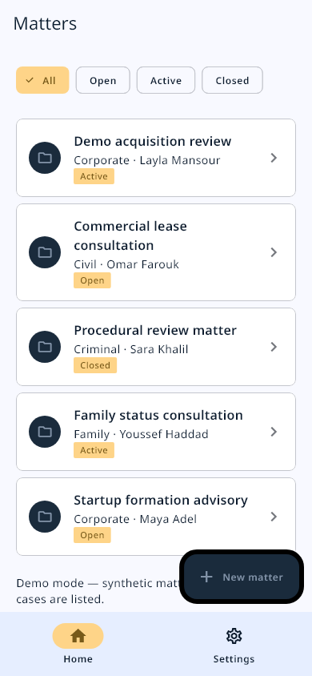 | 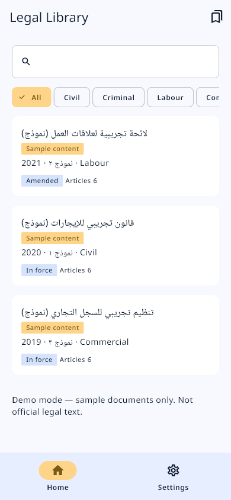 |

| Surface | EN | AR / RTL | Dark |
|---|---|---|---|
| Home |  | 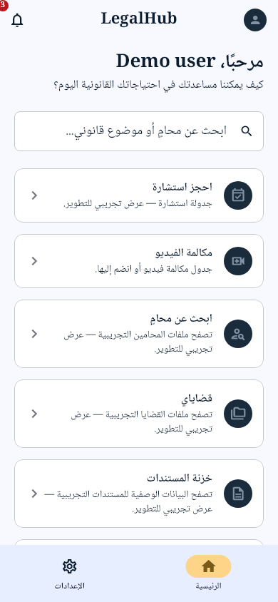 | 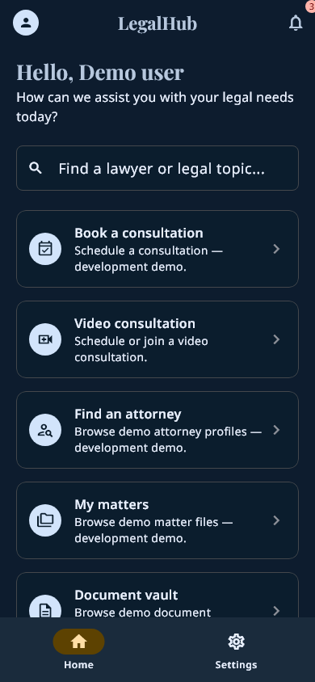 |
| Library |  | 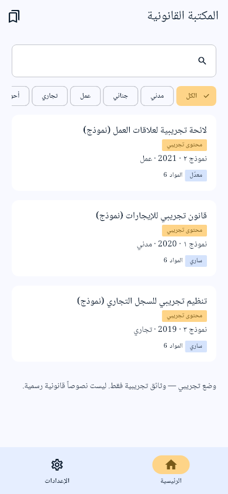 | — |
| Reader | 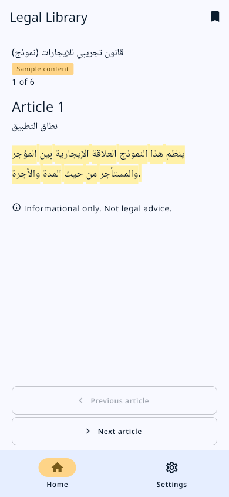 | 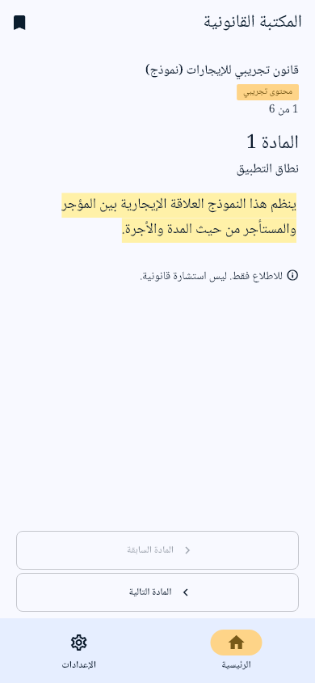 | 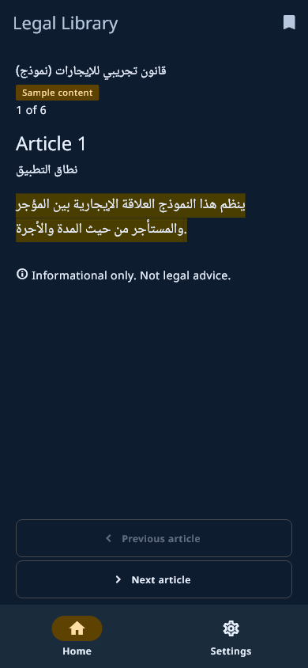 |

All 15 images are generated from the demo build by `CAPTURE_SCREENSHOTS=1 flutter test test/screenshots --update-goldens`; see [`docs/media/README.md`](docs/media/README.md). A 41-second demo capture is available at [`docs/media/demo.gif`](docs/media/demo.gif). The current take was recorded from a debug build and shows a DEBUG ribbon in every frame; a non-debug re-record is pending.

## Highlights

- **Clean Architecture with gateway seams.** Domain/data/presentation per feature; a provider-neutral interface, a fake and a Supabase adapter per data source. No credentials needed for the demo.
- **Server-side authorization.** 31 tables, 32 policy files (43 RLS policies), 86 unique public RPC functions, 30 pgTAP batteries. App/user-data writes are RPC-only; Legal Library corpus writes are restricted by RLS to the platform owner (the owner-run importer uses direct SQL); a service-role key is rejected at startup.
- **Arabic-aware search.** Unicode normalization and Arabic letter-form folding, so `أ`/`إ`/`آ`/`ا` match; snippets come from matched text, never invented.
- **Anchored highlights.** Offset + quote + body hash with stale detection when source text changes.
- **Three languages, RTL throughout.** English, Arabic and Turkish; 1,074 l10n keys per locale with an enforced parity gate.
- **Phone to tablet.** One breakpoint contract for the navigation rail, two-pane master/detail and RTL-aware spacing.
- **Accessibility gates.** Tap-target/label guidelines on 12 surfaces; 14 theme token pairs pinned at 4.5:1. See [`docs/accessibility_statement.md`](docs/accessibility_statement.md).
- **Measured verification.** 2,420 tracked test declarations (2,447 run, 13 skipped), 84.60% line coverage (lcov aggregate LH=18,466 / LF=21,827), 45 screens, 33 migration files, 11 ADRs — all gates run in CI.

## Architecture

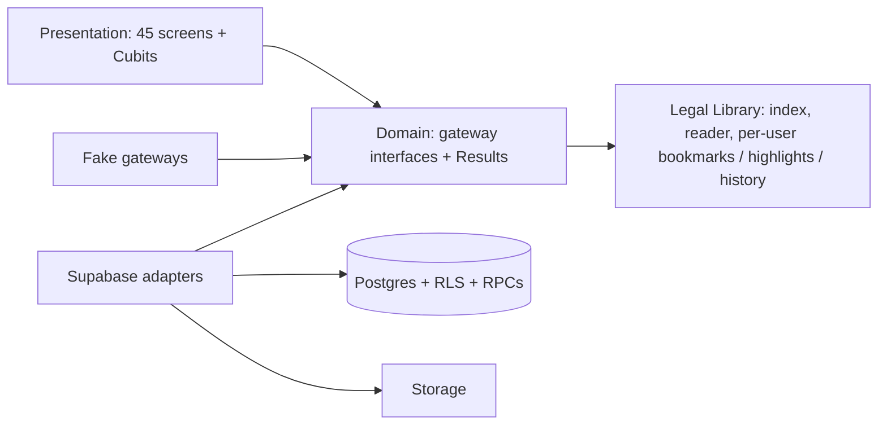

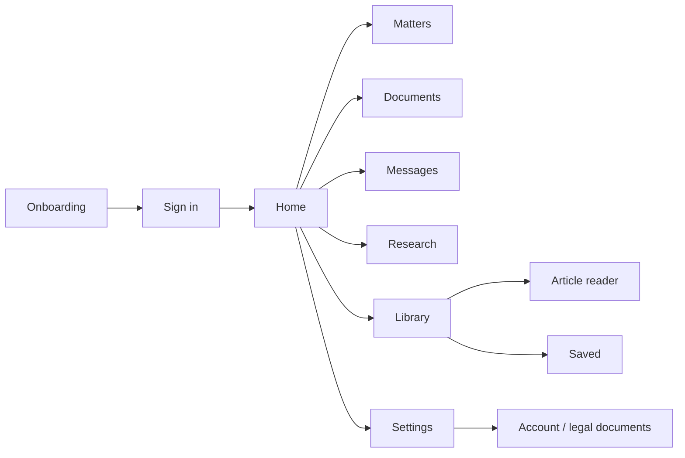

## Tech stack

| Concern | Choice |
|---|---|
| Framework | Flutter 3.47.5 / Dart 3.13.4 |
| State and routing | `flutter_bloc` Cubits, `go_router` 17, `get_it` 9 |
| Backend | `supabase_flutter` 2 (Postgres, Realtime, Storage, Functions) |
| Storage | `flutter_secure_storage` 11 (session), `shared_preferences` 2 (preferences) |
| Media and links | `livekit_client` 2, `file_selector` 1, `url_launcher` 6, `app_links` 7 |
| Localization | `flutter_localizations` + `intl` |

## Quick start

Demo mode needs no account, no `.env` and no backend:

```bash
flutter pub get
flutter run --flavor development -t lib/main_development.dart
```

To point the app at Supabase, fill the URL and **anon** key (a service-role key is rejected at startup):

```bash
cp .env.development.example .env.development
flutter run --flavor development -t lib/main_development.dart --dart-define-from-file=.env.development
```

Full verification commands and release notes are in [`docs/DEEP_DIVE.md`](docs/DEEP_DIVE.md).

## Honest status

| Area | State |
|---|---|
| Practice management, auth, messaging, vault, invoicing demo | Done |
| Legal Library | Done over **sample corpus**; importer for real text is owner-supplied |
| Profile edit, password change, in-app privacy/terms | Done |
| Account deletion | Done for app-owned data; **partial** — provider-side records are not removed |
| Payments, AI research, video consultations | Provider-gated demo surfaces, not live services |
| Push delivery, offline outbox, iOS release, live payments | Planned / not done |
| Legal text | Draft for counsel review; owner fills `LegalConfig` and hosts the docs |

## Engineering docs

- [`docs/DEEP_DIVE.md`](docs/DEEP_DIVE.md) — engineering record
- [`docs/adr/`](docs/adr/) — 11 architecture decision records
- [`docs/permission_matrix.md`](docs/permission_matrix.md) — roles versus capabilities
- [`docs/accessibility_statement.md`](docs/accessibility_statement.md) — accessibility test scope
- [`docs/legal/`](docs/legal/) — privacy and terms drafts
- [`docs/media/README.md`](docs/media/README.md) — screenshot regeneration and GIF script

## License

MIT — see [`LICENSE`](LICENSE).
